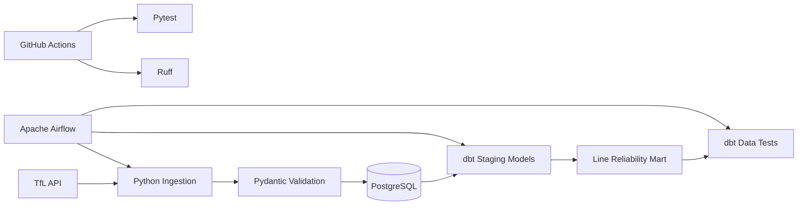

# London Transport Data Platform


A data engineering platform that ingests live London Underground data from the Transport for London API, validates and persists recurring snapshots in PostgreSQL, transforms them with dbt, and orchestrates the end-to-end workflow with Apache Airflow.

The project turns a real-time API into a historical analytical dataset that can be used to measure service performance and disruption over time.

## Architecture



The scheduled Airflow workflow is:

```text
ingest_tfl
    ↓
dbt_run
    ↓
dbt_test
```

It runs hourly with catch-up disabled so historical observations are collected from the point the pipeline is running rather than creating artificial historical snapshots.

## What the Project Does

The pipeline retrieves current Tube line and status data from TfL, validates the payloads using Pydantic, and loads the results into PostgreSQL.

Two different persistence strategies are used:

- **Tube lines are upserted** because each Underground line represents a stable entity identified by `line_id`.
- **Status observations are appended** because repeated observations are the historical data the platform is intended to preserve.

This converts TfL's real-time status API into an accumulating historical dataset.

dbt then transforms the persisted data into staging models and an analytics-ready reliability mart.

## Data Flow

```text
TfL API
   │
   ▼
fetch_tube_lines()
fetch_tube_status()
   │
   ▼
Pydantic validation
   │
   ▼
PostgreSQL
├── tube_lines
└── tube_status_snapshots
   │
   ▼
dbt staging
├── stg_tube_lines
└── stg_tube_status_snapshots
   │
   ▼
mart_line_reliability
```

## Analytical Model

The `mart_line_reliability` model has a grain of:

> **one row per London Underground line**

It calculates:

- total status observations
- Good Service observations
- disrupted observations
- percentage of collected observations reporting Good Service

The reliability percentage is calculated as:

```text
Good Service observations
------------------------- × 100
Total observations
```

TfL status severity `10` is treated as **Good Service**. Other observed status severities are treated as disrupted observations.

This metric represents the percentage of snapshots collected by this pipeline in which TfL reported Good Service. It should not be interpreted as an official TfL availability or SLA metric.

## Tech Stack

| Area | Technology |
|---|---|
| Language | Python 3.13 |
| API ingestion | Requests |
| Validation | Pydantic |
| Database | PostgreSQL 17 |
| Database client | psycopg |
| Transformation | dbt Core / dbt-postgres |
| Orchestration | Apache Airflow 3.4 |
| Containers | Docker / Docker Compose |
| Testing | pytest |
| Linting | Ruff |
| CI | GitHub Actions |

## Repository Structure

```text
.
├── .github/
│   └── workflows/
│       └── ci.yml
│
├── airflow/
│   ├── dags/
│   │   └── tfl_pipeline_dag.py
│   └── Dockerfile
│
├── dbt/
│   ├── models/
│   │   ├── mart_line_reliability.sql
│   │   ├── schema.yml
│   │   ├── sources.yml
│   │   ├── stg_tube_lines.sql
│   │   └── stg_tube_status_snapshots.sql
│   ├── tests/
│   │   └── assert_reliability_percentage_range.sql
│   ├── dbt_project.yml
│   └── profiles.airflow.yml
│
├── sql/
│   ├── 001_create_tube_lines.sql
│   └── 002_create_tube_status_snapshots.sql
│
├── src/
│   └── tfl_pipeline/
│       ├── __main__.py
│       ├── api.py
│       ├── database.py
│       ├── pipeline.py
│       └── validation.py
│
├── tests/
│   ├── test_api.py
│   ├── test_database.py
│   ├── test_database_integration.py
│   ├── test_pipeline.py
│   ├── test_smoke.py
│   └── test_validation.py
│
├── .env.example
├── docker-compose.yml
└── pyproject.toml
```

## Database Design

### `tube_lines`

Stores one row per Underground line.

Key fields include:

```text
line_id
line_name
ingested_at
```

`line_id` is the primary key. Repeated pipeline runs use an upsert so line metadata can be updated without generating duplicate line records.

### `tube_status_snapshots`

Stores the historical observations collected by the pipeline.

Key fields include:

```text
snapshot_id
line_id
observed_at
status_severity
status_description
```

Each ingestion run appends new observations.

`observed_at` represents when this platform observed the status rather than a historical timestamp supplied by TfL.

## Data Validation

Incoming API payloads are validated before persistence using Pydantic models.

Validation covers fields including:

```text
TubeLine
├── id
└── name

TubeStatusSnapshot
├── line_id
├── status_severity
└── status_description
```

Invalid records raise validation errors rather than silently entering the database.

## dbt Models

### Staging

`stg_tube_lines`

Provides the dbt representation of the persisted Tube line data.

`stg_tube_status_snapshots`

Provides the dbt representation of historical status observations.

### Mart

`mart_line_reliability`

Joins line metadata to historical observations and produces one analytical record per Tube line.

A left join is deliberately used so lines can remain represented even when they currently have no observations.

## Data Quality Tests

dbt tests enforce:

- unique `line_id` values in staged Tube lines
- non-null `line_id`
- unique status snapshot IDs
- non-null snapshot IDs
- non-null snapshot line IDs
- valid relationships between snapshots and Tube lines
- unique and non-null line IDs in the reliability mart
- reliability percentages between 0 and 100

The custom reliability test returns failing rows outside the valid percentage range; zero returned rows represents a passing test.

## Python Tests

The Python test suite covers multiple layers of the application.

### API Tests

HTTP requests are mocked to test:

- correct TfL endpoints
- request timeout behaviour
- returned payloads
- HTTP error propagation

### Validation Tests

Tests cover valid and invalid API payloads, including nested TfL status structures and missing required data.

### Database Tests

Database behaviour is tested at two levels:

- mocked unit tests for SQL execution and transaction behaviour
- integration tests against a real PostgreSQL instance

The integration tests verify both Tube line upserts and append-only historical snapshot behaviour.

### Pipeline Tests

The orchestration logic inside the Python ingestion pipeline is tested independently from Airflow.

Tests verify the expected sequence:

```text
fetch
→ validate
→ persist
```

Failure-path tests also ensure downstream operations are not called when an earlier stage fails.

## Airflow Orchestration

The Airflow DAG is defined in:

```text
airflow/dags/tfl_pipeline_dag.py
```

Airflow does not duplicate the ingestion implementation.

Instead, the DAG calls the existing Python pipeline:

```python
from tfl_pipeline.pipeline import run_ingestion
```

This keeps responsibilities separated:

```text
Python pipeline
→ how data is fetched, validated and persisted

Airflow
→ when tasks execute and in what order
```

After ingestion succeeds, Airflow executes:

```text
dbt run
```

followed by:

```text
dbt test
```

A failure at any stage prevents downstream tasks from being treated as successful.

## Local Setup

### Prerequisites

Install:

- Git
- Python 3.13+
- Docker Desktop or Docker Engine with Docker Compose

Clone the repository:

```bash
git clone https://github.com/getredportfolio/london-transport-data-platform.git
cd london-transport-data-platform
```

### 1. Configure Environment Variables

Copy the example environment file:

```bash
cp .env.example .env
```

On PowerShell:

```powershell
Copy-Item .env.example .env
```

Update the password in `.env` if required.

Example:

```env
POSTGRES_HOST=127.0.0.1
POSTGRES_DB=tfl
POSTGRES_USER=tfl_user
POSTGRES_PASSWORD=change_me
POSTGRES_PORT=5433
```

Port `5433` is exposed on the host so it does not conflict with an existing local PostgreSQL installation using `5432`.

Inside Docker, Airflow communicates with the PostgreSQL service using:

```text
postgres:5432
```

### 2. Create the Python Environment

```bash
python -m venv .venv
```

Activate it.

PowerShell:

```powershell
.\.venv\Scripts\Activate.ps1
```

macOS/Linux:

```bash
source .venv/bin/activate
```

Install the project and development dependencies:

```bash
pip install -e ".[dev]"
```

### 3. Start PostgreSQL

```bash
docker compose up -d postgres
```

Check its status:

```bash
docker compose ps
```

### 4. Initialise the Database Schema

Run:

```bash
python -c "from pathlib import Path; from tfl_pipeline.database import get_connection; conn = get_connection(); conn.execute(Path('sql/001_create_tube_lines.sql').read_text()); conn.execute(Path('sql/002_create_tube_status_snapshots.sql').read_text()); conn.commit(); conn.close()"
```

### 5. Start Airflow

Build and start the Airflow container:

```bash
docker compose up -d --build airflow
```

Check the services:

```bash
docker compose ps
```

Airflow is exposed at:

```text
http://localhost:8080
```

For the development-only standalone Airflow environment, the generated admin password can be found in the logs:

```bash
docker compose logs airflow
```

### 6. Run the Pipeline

The DAG is named:

```text
tfl_data_pipeline
```

Triggering it executes:

```text
ingest_tfl
    ↓
dbt_run
    ↓
dbt_test
```

The DAG is configured with an hourly schedule once enabled.

## Running the Python Pipeline Directly

The ingestion layer can also be executed independently of Airflow:

```bash
python -m tfl_pipeline
```

This is useful for development and debugging because the core ingestion code does not depend on the Airflow scheduler.

## Running dbt Manually

dbt can be executed from inside the Airflow container using the same project and profile used by the DAG.

Run the models:

```bash
docker compose exec airflow dbt run \
  --project-dir /opt/airflow/app/dbt \
  --profiles-dir /opt/airflow/app/dbt
```

Run the data tests:

```bash
docker compose exec airflow dbt test \
  --project-dir /opt/airflow/app/dbt \
  --profiles-dir /opt/airflow/app/dbt
```

## Running Tests Locally

Run the Python test suite:

```bash
pytest
```

Run Ruff:

```bash
ruff check .
```

## Continuous Integration

GitHub Actions runs on pushes and pull requests targeting `main`.

The current CI pipeline:

```text
checkout
    ↓
Python 3.13
    ↓
install dependencies
    ↓
start PostgreSQL 17
    ↓
create database schema
    ↓
Ruff
    ↓
pytest
```

The PostgreSQL integration tests therefore run against a real database service in CI rather than relying exclusively on mocked database behaviour.

## Engineering Decisions

### Persist Snapshots Instead of Only Storing the Current Status

The TfL endpoint exposes current status data. Persisting each observation creates the historical dataset required for later reliability and disruption analysis.

### Upsert Entities, Append Observations

Tube lines and status snapshots have different data semantics.

A line represents an entity, so duplicate identifiers should be prevented.

A status snapshot represents an observation at a particular point in time, so repeated observations are intentional.

### Validate Before Persistence

Pydantic validation creates a boundary between external API data and trusted application data.

Malformed payloads fail before reaching PostgreSQL.

### Keep Orchestration Separate From Business Logic

Airflow calls the existing Python ingestion function instead of reimplementing API and database logic inside the DAG.

This keeps the ingestion layer independently testable and executable.

### Separate Raw, Staging and Analytical Layers

PostgreSQL stores the persisted operational data, while dbt creates staging models and purpose-built analytical datasets.

This separates ingestion concerns from analytics logic.

## Current Limitations and Next Steps

This is a portfolio/development platform rather than a production deployment.

Potential extensions include:

- run dbt models and dbt tests directly in GitHub Actions
- persist Airflow metadata across container recreation
- replace Airflow Standalone and its development authentication with a production deployment model
- add richer disruption and time-window analytics
- collect a longer observation history for more meaningful reliability analysis
- add monitoring and alerting for failed scheduled runs
- introduce additional TfL datasets and transport modes
- add analytical dashboards on top of the dbt marts

## Project Goal

The project demonstrates an end-to-end data engineering workflow rather than only an API script:

```text
API ingestion
+ validation
+ relational persistence
+ historical data modelling
+ SQL transformation
+ data-quality testing
+ orchestration
+ containerisation
+ integration testing
+ continuous integration
```

The result is a reproducible platform that continuously converts live transport data into tested, analytics-ready historical datasets.
